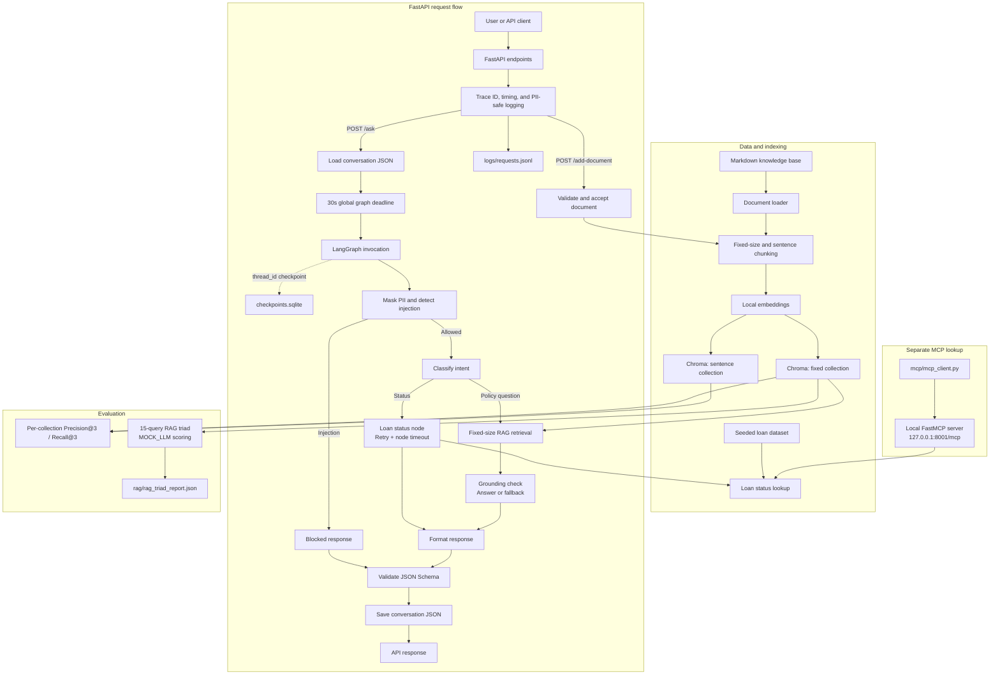

# Cred (Banking & FinTech) Track — Support Agent

I completed the Cred (Banking & FinTech) track for the final 
capstone. This repository implements a production-minded loan 
support agent for Cred-style lending operations, combining a 
deterministic loan-application dataset, a RAG knowledge base, 
a LangGraph orchestration layer, tool calling, memory 
guardrails, MCP tool exposure, FastAPI deployment, and 
end-to-end evaluation under a zero-API-key `MOCK_LLM` mode.

## Project Overview

This repository implements a loan-support workflow with local retrieval, structured tools,
conversation state, API deployment, and operational safeguards. It can:

- answer policy questions from 16 topic-specific Markdown documents indexed with fixed-size and sentence-based chunks
- look up a loan application by `record_id` and return its status with a fraud/recency escalation score
- retain conversation memory and persist LangGraph execution checkpoints in SQLite
- mask Aadhaar, PAN, Indian mobile numbers, and labeled bank-account numbers before model input and request logging
- block prompt-injection attempts and refuse unsupported RAG answers
- validate agent responses against a JSON Schema
- serve `/ask` and `/add-document` through FastAPI and record requests as traceable JSONL entries
- expose the loan lookup through a separate FastMCP HTTP server and client
- apply node-level retries/timeouts and a whole-graph deadline
- evaluate retrieval strategies and a 15-query RAG triad under deterministic `MOCK_LLM` scoring, without an external model API

## Project Compliance Matrix

This repository is aligned as per the project requirements.The sections below break the capstone into clear, readable groups with evidence and completion status for each requirement.

### Part 1 — Dataset Design & RAG Core

| Requirement | Evidence | Status |
|---|---|---|
| Deterministic seeded dataset generator with 40+ records | [dataset.py](dataset.py) | ✅ Complete |
| Required loan categories included | [dataset.py](dataset.py) | ✅ Complete |
| Required status values included | [dataset.py](dataset.py) | ✅ Complete |
| Fraud-review percentage within the required range | [dataset.py](dataset.py) | ✅ Complete |
| 12+ banking policy documents in the knowledge base | [knowledge_base/documents.py](knowledge_base/documents.py), [knowledge_base/docs](knowledge_base/docs) | ✅ Complete |
| Fixed-size and sentence chunking strategies implemented | [rag/chunks.py](rag/chunks.py) | ✅ Complete |
| Separate Chroma collections for each strategy | [rag/embeddings.py](rag/embeddings.py), [rag/retriever.py](rag/retriever.py) | ✅ Complete |
| Grounded retrieval with empirical threshold calibration | [rag/retriever.py](rag/retriever.py) | ✅ Complete |
| Precision@3 and Recall@3 evaluation | [rag/evaluate.py](rag/evaluate.py) | ✅ Complete |

### Part 2 — LangGraph Agent with Tools, Memory & Guardrails

| Requirement | Evidence | Status |
|---|---|---|
| Loan status lookup with escalation logic | [agent/tool.py](agent/tool.py) | ✅ Complete |
| LangGraph graph with routing logic and 4+ nodes | [agent/graph.py](agent/graph.py) | ✅ Complete |
| Persistent memory across turns | [agent/memory.py](agent/memory.py), [agent/graph.py](agent/graph.py) | ✅ Complete |
| Structured response schema validation | [agent/structured_output.py](agent/structured_output.py) | ✅ Complete |
| Input-side PII masking and prompt-injection detection | [agent/guardrails.py](agent/guardrails.py), [agent/graph.py](agent/graph.py) | ✅ Complete |
| Output-side groundedness refusal for unsupported answers | [agent/guardrails.py](agent/guardrails.py), [agent/graph.py](agent/graph.py) | ✅ Complete |

### Part 3 — Evaluation, Observability & FastAPI Deployment

| Requirement | Evidence | Status |
|---|---|---|
| FastAPI deployment with request validation | [api/deploy.py](api/deploy.py) | ✅ Complete |
| Structured JSONL logging with trace IDs and timing | [api/structured_logging.py](api/structured_logging.py) | ✅ Complete |
| 15-query MOCK_LLM triad evaluation | [rag/evaluate.py](rag/evaluate.py) | ✅ Complete |
| Per-query and average scores for context relevance, groundedness, and answer relevance | [rag/evaluate.py](rag/evaluate.py) | ✅ Complete |

### Part 4 — Resilience & Interoperability

| Requirement | Evidence | Status |
|---|---|---|
| MCP tool exposure via FastMCP | [mcp/mcp_server.py](mcp/mcp_server.py), [mcp/mcp_client.py](mcp/mcp_client.py) | ✅ Complete |
| SQLite checkpointing for resumable runs | [agent/graph.py](agent/graph.py) | ✅ Complete |
| Retry and timeout policies | [agent/graph.py](agent/graph.py) | ✅ Complete |

### Submission Readiness

| Requirement | Evidence | Status |
|---|---|---|
| Repository structure suitable for public GitHub submission | Repo root modules and documentation | ✅ Ready |
| README documents the implementation and MOCK_LLM setup | [README.md](README.md) | ✅ Ready |

### Verification summary

The project was verified with the repository’s test suite:

- Command: `python -m unittest discover -s tests -q`
- Result: 8 tests ran successfully and all passed (`OK`)

This confirms the project is in a stable, submission-ready state for the Cred Banking & FinTech capstone.

## Project Workflow



## Dataset Design Choices (Part 1, Task 1)

The dataset is generated deterministically with a fixed seed 
and weighted random sampling so the 
output is reproducible and the grader can regenerate the same 
distribution.

- Seed: `75`
    - Category weights: 
`Personal Loan=0.30`, 
`Home Loan=0.22`, 
`Auto Loan=0.18`, 
`Education Loan=0.15`, 
`Business Loan=0.15`
    - Status weights: 
`Submitted=0.30`,
`Under Review=0.25`, 
`Approved=0.20`,
`Rejected=0.15`, 
`Disbursed=0.10`
    - Loan amount range: `50,000 INR to 80,00,000 INR`, 
with per-category ranges tailored to realistic Indian lending 
bands:
- Personal Loan: `50,000–20,00,000`
- Home Loan: `4,00,000–80,00,000`
- Auto Loan: `1,00,000–30,00,000`
- Education Loan: `1,00,000–25,00,000`
- Business Loan: `3,00,000–60,00,000`

- Reasoning: these ranges reflect common Indian credit 
products and borrower needs, while keeping 
the distribution realistic for support-agent use cases.

The generated dataset contains at least 40+ records with each 
required category appearing at 
least 3 times, each required status appearing at least once, 
and the fraud-review percentage 
intentionally kept within the required 10–30% range by 
regeneration control rather than manual 
record editing.


## Knowledge Base Structure

The knowledge base is organized as multiple markdown documents, one per topic, under the 
`knowledge_base/docs` folder instead of a single monolithic file. Each file contains a `doc_id`, 
`title`, and body text, and the project loads them dynamically through `knowledge_base/documents.
py` before chunking and embedding them into ChromaDB.

Examples of documents in this structure include:

- `personal-loan-eligibility.md`
- `home-loan-eligibility.md`
- `kyc-document-requirements.md`
- `fraud-dispute-resolution.md`
- `nri-account-eligibility.md`

This keeps the content modular, easier to maintain, and simpler to extend 
when adding new banking 
policy documents.

## Chunking Strategy

The chunking layer is implemented in `rag/chunks.py` and creates two separate retrieval strategies 
for the same knowledge base:

- `chunk_by_fixed_size(...)`: splits each document into fixed-size text windows with a small 
overlap to preserve context across boundaries.
- `chunk_by_sentence(...)`: groups sentences into chunks that stay under a max character limit so 
each chunk remains semantically coherent.

The `build_chunk_sets(...)` function produces two output sets, `fixed` and `sentence`, which are 
indexed separately in ChromaDB. This lets the project compare retrieval quality across chunking 
styles and choose the better-performing option for the deployed agent.

## Embedding and Indexing

The embedding layer is implemented in `rag/embeddings.py`. It builds both chunk sets from the 
source documents, creates a local `SentenceTransformer` embedding model, and persists each chunk 
strategy in its own Chroma collection named `knowledge_base_fixed` and `knowledge_base_sentence`.

This design keeps retrieval consistent and separate across strategies: the same underlying 
documents are embedded once per chunking style, and both collections are later queried for 
similarity search. The final vector store is stored locally under the project’s `chroma_db` folder 
so the agent can retrieve grounded context without any external API dependency.


## Retrieval and Grounding Logic

The retrieval layer is implemented in `rag/retriever.py`. It loads both Chroma collections, 
encodes the user query with `SentenceTransformer`, retrieves the top-k chunks from the selected 
strategy, and computes cosine similarity between the query embedding and each stored chunk 
embedding.

The project then reconstructs the parent document for the best match and returns a grounded answer 
only if the top similarity is above the configured threshold. If the result is below the 
threshold, the system falls back with the message: `I don't know. The query is not supported by 
the available knowledge base.`

This logic is used by the agent to decide whether a query can be answered from the knowledge base 
or whether the system should refuse to answer.

## Grounded Generation and Similarity Threshold

The grounded retriever uses the local `all-MiniLM-L6-v2` model 
to embed queries and ChromaDB 
chunks. It retrieves the top three chunks from the fixed-size 
and sentence collections, scores 
them with normalized cosine similarity, and answers only from 
the retrieved context.

Under `MOCK_LLM`, the generator has no external model, so 
retrieval similarity is the only 
grounding signal. The threshold is calibrated from observed 
top-1 similarities rather than a 
tutorial preset.

### Measured top-1 similarities

| Query type    | Query                                      | Top-1 cosine similarity |
|---------------|--------------------------------------------|-------------------------|
| In scope      | What documents are normally required for KYC?               | 0.7155 |
| In scope      | What are the eligibility requirements for a personal loan?  | 0.7971 |
| In scope      | How are interest rate slabs determined?                     | 0.6947 |
| In scope      | How is the account closure process completed?               | 0.6706 |
| In scope      | What are the main factors affecting a credit score?         | 0.6815 |
| Out of scope  | How do I bake a chocolate cake?                             | 0.1089 |
| Out of scope  | How is the weather today?                                   | 0.1442 |


The highest measured in-scope similarity was `0.7971`, and the 
lowest measured out-of-scope 
similarity was `0.1089`. Their midpoint is `0.4530`:

$$
\text{threshold} = \frac{0.7971 + 0.1089}{2} = 0.4530
$$

### Grounded generation demonstration

The retriever was run against the following in-scope queries:

1. What documents are normally required for KYC?
2. What are the eligibility requirements for a personal loan?
3. How are interest rate slabs determined?
4. How is the account closure process completed?
5. What are the main factors affecting a credit score?

The deliberately out-of-scope query below must trigger the 
fallback:

- How do I bake a chocolate cake?
- How is the weather today?
Run the benchmark with:

```powershell
python -c "from rag.retriever import benchmark_queries; import 
json; print(json.dumps
(benchmark_queries(), indent=2))"
```

### Strategy comparison

Each collection is queried independently for its own top three chunks; retrieved chunks are mapped 
to parent documents and deduplicated before scoring. Each query has one relevant parent document, so 
the arithmetic below shows relevant documents retrieved / unique documents retrieved for Precision@3 
and relevant documents retrieved / relevant documents for Recall@3.

| Query | Fixed Precision@3 | Fixed Recall@3 | Sentence Precision@3 | Sentence Recall@3 |
|---|---:|---:|---:|---:|
| KYC document requirements | `1/1 = 1.00` | `1/1 = 1.00` | `1/1 = 1.00` | `1/1 = 1.00` |
| Personal-loan eligibility | `1/3 = 0.33` | `1/1 = 1.00` | `1/3 = 0.33` | `1/1 = 1.00` |
| Interest-rate slabs | `1/2 = 0.50` | `1/1 = 1.00` | `1/2 = 0.50` | `1/1 = 1.00` |
| Account closure | `1/2 = 0.50` | `1/1 = 1.00` | `1/2 = 0.50` | `1/1 = 1.00` |
| Credit-score factors | `1/1 = 1.00` | `1/1 = 1.00` | `1/1 = 1.00` | `1/1 = 1.00` |
| **Average** | **`0.67`** | **`1.00`** | **`0.67`** | **`1.00`** |

The two strategies tie on this five-query sample: both average Precision@3 `0.67` and Recall@3 
`1.00`. I recommend keeping fixed-size as the deployed strategy for now because these results show no 
measured retrieval benefit to justify switching the collection used by the agent; this small test set 
does not establish a general winner. Re-run `python rag/evaluate.py` to reproduce the per-query 
arithmetic and averages.

## Loan Status Tool and Escalation Score

The loan lookup and escalation logic lives in `agent/tool.py`. The function 
`check_loan_application_status(record_id)` searches the generated dataset, reads the application 
record, and calculates a weighted escalation score that combines fraud risk and recency of 
creation.

The score is `0.6 × fraud_signal + 0.4 × recency_signal`, where `fraud_signal` is `1` when 
`flagged_for_fraud_review` is true and `0` otherwise, and `recency_signal = min
(days_since_created, 30) / 30`. This means a newly created, unflagged application stays low risk, 
while an older flagged application can rise above the escalation threshold.

The threshold is set at `0.90`, and the code returns both the numeric score and a boolean 
`escalate` decision so the agent can decide whether a loan case should be reviewed manually.

The escalation threshold is `0.90`; scores strictly above it recommend escalation. In the 
generated 50-record dataset, the nearest-rank 80th percentile of `days_since_created` is 23 days. 
A fraud-flagged application at 23 days scores `0.6 + 0.4 × (23/30) = 0.9067`, above the 
threshold, while an unflagged application cannot score above `0.40`. This focuses escalation on 
fraud-flagged applications that are also among the older cases in this dataset.

## LangGraph Orchestration

The measured midpoint `0.4530` is the runtime default 
(`DEFAULT_GROUNDEDNESS_THRESHOLD`). Queries with a top-1 similarity below this value trigger the 
fallback: `I don't know. The query is not supported by the available knowledge base.`

## Persisted Conversation Memory

Conversation history is stored as JSON in `agent/conversation_history.json`, keyed by 
conversation ID. Each turn saves the user query and assistant response; the most recent 
application ID is retained to resolve follow-up status questions.

Run `python agent/graph.py` to see both cases. In the continuing transcript, the second query 
(`What is its status?`) reuses the application ID from the first turn; the fresh transcript 
starts with no saved ID and asks the user to provide one.

## Structured Agent Responses

Every graph response conforms to the JSON Schema in `agent/structured_output.py` and is validated 
by a graph node before completion. The response object has `intent`, `answer`, `fallback`, 
`record_id`, `escalation_score`, and `escalate` fields; nullable status-only fields are `null` 
for RAG answers.

## Guardrails

Before intent routing, `agent/guardrails.py` masks fixed-format Aadhaar numbers, PAN identifiers, 
and labeled bank account numbers and Indian mobile numbers, and blocks common prompt-injection attempts to override instructions 
or reveal hidden prompts. RAG answers pass an output-side groundedness check and are refused when 
retrieval falls back, provides no context, or scores below the retriever's threshold.

Run `python agent/graph.py` to demonstrate all three guardrails: the test PII values are 
redacted, an instruction-override request is blocked, and an unrelated cake question receives an 
`I don't know` response.

## FastAPI Deployment

Install the dependencies from `requirements.txt`, then start the API from the project root:

```powershell
python -m pip install -r requirements.txt
uvicorn api.deploy:app --reload
```

`POST /ask` accepts a query and optional conversation ID, then returns the schema-validated agent 
response. `POST /add-document` accepts 
a unique document ID, title, and text, embeds it locally, and indexes its chunks in both ChromaDB 
strategies. Interactive request models 
and endpoint docs are available at `http://127.0.0.1:8000/docs`.

## Structured Request Logging

FastAPI request logging is implemented in `api/structured_logging.py` and connected through 
middleware in `api/deploy.py`. Each request is appended as one JSON Lines entry to `logs/requests.
jsonl`, including its timestamp, HTTP method, route, status code, duration in milliseconds, and 
trace ID. The middleware accepts an incoming `X-Trace-Id` header or generates a UUID, then returns 
that trace ID in the response header.

Before logging, request text is masked with the same PII guardrail used for model input. 
Fixed-format Aadhaar numbers, PAN identifiers, labeled bank account numbers, and Indian mobile 
numbers are therefore not written to the log in raw form. The logging behavior is covered by 
`tests/test_structured_logging.py`.

## RAG Triad Evaluation

Run `python -m rag.evaluate --rag-triad` from the project root to evaluate 15 queries against the 
deployed fixed-size RAG collection. The set covers all 12 required knowledge-base topics, includes 
an additional cross-topic loan-closure query, and has two deliberately out-of-scope queries. A 
deterministic `MOCK_LLM` judge prompt scores context relevance, groundedness, and answer relevance 
for each query on a 1–5 scale. The local mock applies meaningful-token coverage to the prompt 
inputs, so the evaluation runs without a model API or network call; it is reproducible, but is not 
a substitute for human or real-LLM semantic judgment.

The command prints every query's three scores and their averages, and writes the full report, 
rationales, and judge prompt to `rag/rag_triad_report.json`. Current averages are context 
relevance `2.820`, groundedness `4.913`, and answer relevance `3.540` across all 15 queries. Run 
`python tests/test_rag_triad.py` to check the test-set coverage and mock judge behavior.

## MCP Loan Lookup

`mcp/mcp_server.py` exposes `check_loan_application_status` through FastMCP without changing the 
LangGraph agent. Install the project dependencies with `python -m pip install -r requirements.
txt`, then start the private HTTP server from the project root:

```powershell
python mcp/mcp_server.py
```

The server binds only to `127.0.0.1:8001` and mounts MCP at `http://127.0.0.1:8001/mcp`. In a 
separate terminal, run the independent client:

```powershell
python mcp/mcp_client.py
```

The client connects to `/mcp`, invokes the lookup for two different IDs from `dataset.py`, and 
prints each standardized MCP tool response as JSON. Set `MCP_SERVER_URL` if the local server is 
using another address.

## SQLite Checkpointing

The LangGraph workflow uses `langgraph-checkpoint-sqlite` and stores checkpoints in `checkpoints.
sqlite`. Normal `run_conversation(...)` calls use their conversation ID as the LangGraph 
`thread_id`, so checkpoint state is isolated by conversation.

Run `python -m agent.checkpoint_demo` to demonstrate interruption and recovery. The demo executes 
`input_guardrails` and `classify_intent`, pauses before the remaining nodes, closes and reopens 
the SQLite saver, then resumes the same `thread_id`. Its output prints the checkpointed/restored 
state and the node-update events; the previously completed nodes are listed as not re-executed.

## Timeouts and Retries

The `loan_status_tool` node has a 5-second run timeout and a three-attempt exponential-backoff 
retry policy (`0.2`-second initial interval, `2.0`-second maximum interval, factor `2`, with 
jitter). Normal `run_conversation(...)` calls run asynchronously with a 30-second global graph 
deadline; a timeout cancels the graph task and raises a clear `GraphRunTimeoutError`.

Run `python -m agent.resilience_demo` to verify the policies. It simulates a transient node 
failure twice and confirms recovery on attempt three, then demonstrates a cooperative per-node 
timeout and a global timeout that cancels a slow node before its downstream node executes.

